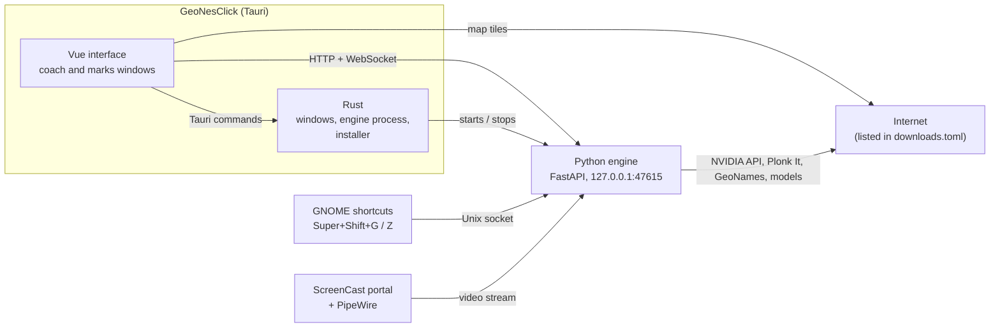
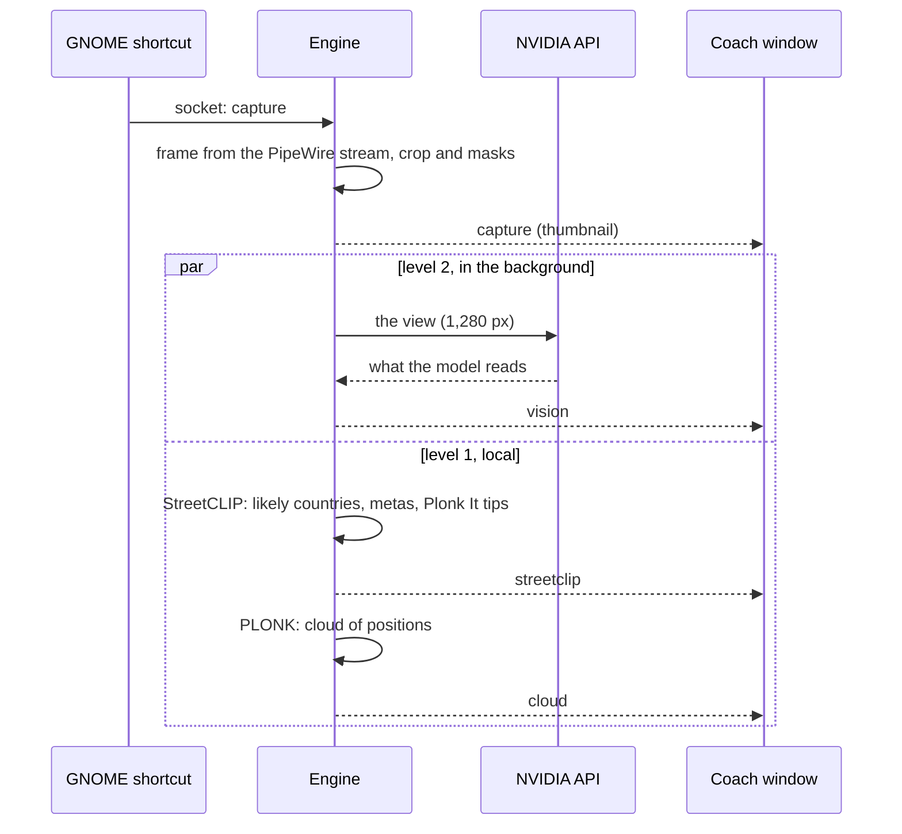
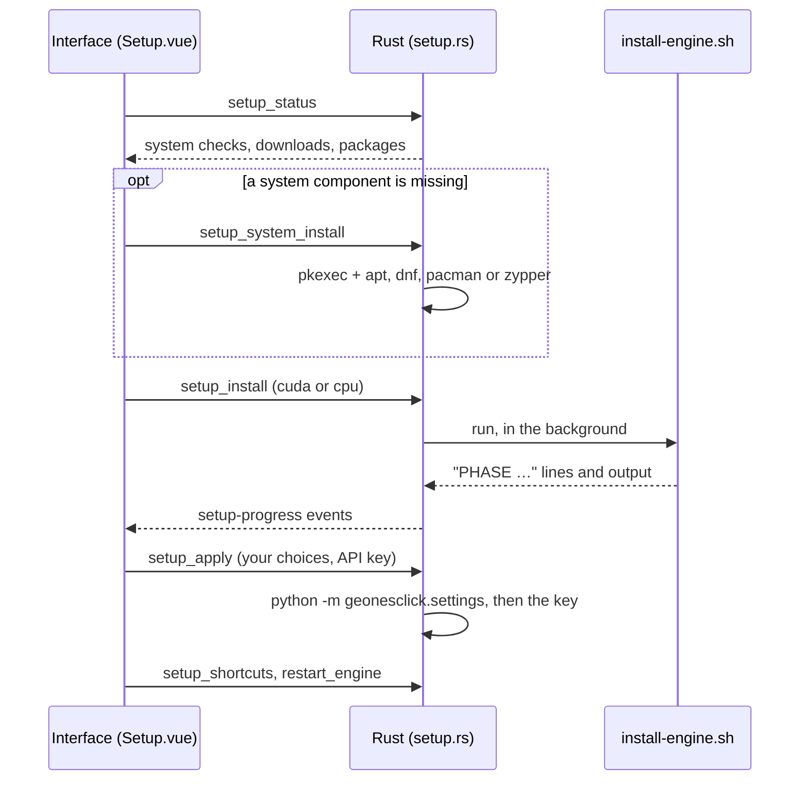

[← README](../README.md)

# Architecture

GeoNesClick is one desktop app made of three parts, each in its own language:

| Part | Language | Where | Role |
|---|---|---|---|
| **Tauri shell** | Rust | `app/src-tauri/` | the windows, starting and stopping the engine, the first-launch installer |
| **Interface** | Vue 3 + TypeScript | `app/src/` | everything shown in the coach and marks windows |
| **Engine** | Python 3.12 | `engine/src/geonesclick/` | screen capture, AI models, local rules, Plonk It, settings, a local server |

The engine is a separate process: the AI libraries it needs (PyTorch, Transformers, GStreamer bindings) only exist in
Python. The interface talks to it directly, over HTTP and a WebSocket on `127.0.0.1`; the Rust side only starts it,
stops it and installs it.



## Who talks to whom

| From → to | Channel | What | Guard |
|---|---|---|---|
| Interface → Rust | Tauri commands (`invoke`) | installer (`setup_status`, `setup_system_install`, `setup_install`, `setup_apply`, `setup_shortcuts`), `set_language`, `restart_engine` | only the commands registered in `lib.rs`; window permissions in `app/src-tauri/capabilities/` |
| Rust → interface | Tauri events | installation progress (`setup-progress`) | — |
| Rust → engine | child process | `python -m geonesclick`, stopped with SIGTERM when the app closes (and by the kernel if the app dies) | the engine's environment is cleaned of the AppImage's variables (`host_command` in `setup.rs`) |
| Interface → engine | HTTP, `http://127.0.0.1:47615` | settings, marks, locks, storage, "Where was it?" | the engine listens on `127.0.0.1` only and refuses any other `Origin` |
| Engine → interface | WebSocket `/ws` | the state, then each event of a round (`capture`, `streetclip`, `vision`, `cloud`, `freeze`…; the full list is the `Message` type in `app/src/engine.ts`) | same origin check; the window's CSP only allows this address |
| GNOME → engine | Unix socket `$XDG_RUNTIME_DIR/geonesclick.sock` | `capture` or `mark`, sent by `python -m geonesclick.trigger` | socket readable and writable by you only (0600) |
| Portal → engine | PipeWire stream | the shared window, kept open; a frame is taken at each capture | GNOME asks which window to share; the permission is remembered |

## A capture, step by step



The coach shows each part as it arrives, according to the help level: StreetCLIP answers first, the vision model a
few seconds later. Nothing waits for the network before the local result is shown.

## Marks

The marks window is created hidden at startup (`tauri.conf.json`) so that it shows without delay. Super+Shift+Z sends
`mark` to the socket: the engine takes a new frame (a capture must have opened the round first) and announces it
(`freeze`); the marks window, listening on the same WebSocket, shows it full screen. You draw your boxes; the window
sends them (`POST /marks`), hides, and the engine crops each box from the full-resolution frame, has the vision model
transcribe it, then applies the local rules (`evidence.py`, `places.py`, `locate.py`). The conclusions reach the
coach window over the WebSocket. Both windows load the same page: `?view=marks` selects the marks interface
(`app/src/main.ts`).

## First launch (AppImage)



The AppImage stays light (~100 MB): it carries `uv`, the engine as a wheel, PyGObject and pycairo compiled for it,
and the pinned dependencies with their hashes. `install-engine.sh` installs Python 3.12 and the engine in
`~/.local/share/geonesclick/engine/`, then downloads StreetCLIP. Your choices are written before the engine's first
start, so it never downloads an option you declined. On each start, `app/src/main.ts` asks Rust whether the installed
engine matches the AppImage's version; if not, the installer comes back to update it.

## Shared files

- **Translations**: one catalog per language, `engine/src/geonesclick/locales/<lang>.json`, read by the three parts:
  the engine (`i18n.py`), the interface (`app/src/i18n.ts`) and Rust (`app/src-tauri/src/i18n.rs`, compiled in by
  `build.rs`). See [development.md › Translations](development.md#translations).
- **Downloads**: `engine/src/geonesclick/downloads.toml` lists everything the app downloads or sends. The installer
  shows it before the first byte, the README repeats it, and a test checks that every address in the code is listed.
- **Settings**: `engine/src/geonesclick/default_config.toml` holds the commented defaults; your
  `~/.config/geonesclick/config.toml` overrides them key by key. The engine owns the settings: the interface reads
  and changes them over HTTP, except the security-related ones, which can only be changed in the file (see
  [configuration.md](configuration.md)).

## Repository layout

```
app/                        Tauri shell and interface
  src-tauri/src/lib.rs      windows, engine process, Tauri commands
  src-tauri/src/setup.rs    first-launch installer: system checks, install, shortcuts, removal
  src-tauri/src/i18n.rs     texts of the Rust side, from the shared catalogs
  src-tauri/capabilities/   what each window may do
  src/main.ts               chooses between the installer, the coach and the marks window
  src/engine.ts             connection to the engine (WebSocket + HTTP) and the round's state
  src/i18n.ts               texts of the interface
  src/components/           coach (Countries, CoachMap, Observations, Locks, Marks…), Settings, Setup
  src/MarksOverlay.vue      full-screen marks window
  src/settingsSchema.ts     the settings screen: groups and fields
engine/                     Python engine
  src/geonesclick/          server, capture, StreetCLIP, PLONK, vision, marks and local rules, locks, metas,
                            Plonk It, test set, settings, storage
    locales/                one catalog per language, shared by the three parts
    data/                   Natural Earth 1:50m country outlines (public domain)
  tests/                    engine tests (no network, no display)
  spikes/                   benches (see benchmarks.md)
  dataset/                  test set: labels, the bench's rounds (local images are not versioned)
scripts/
  install.sh                development setup
  build-appimage.sh         builds the AppImage
  install-engine.sh         run by the installer to install the engine
  release-notes.sh          a version's section of CHANGELOG.md, for the release
.github/workflows/          release build
```
